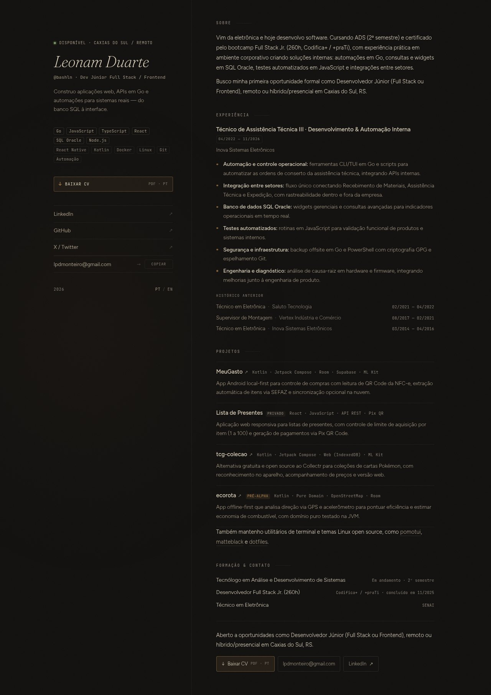
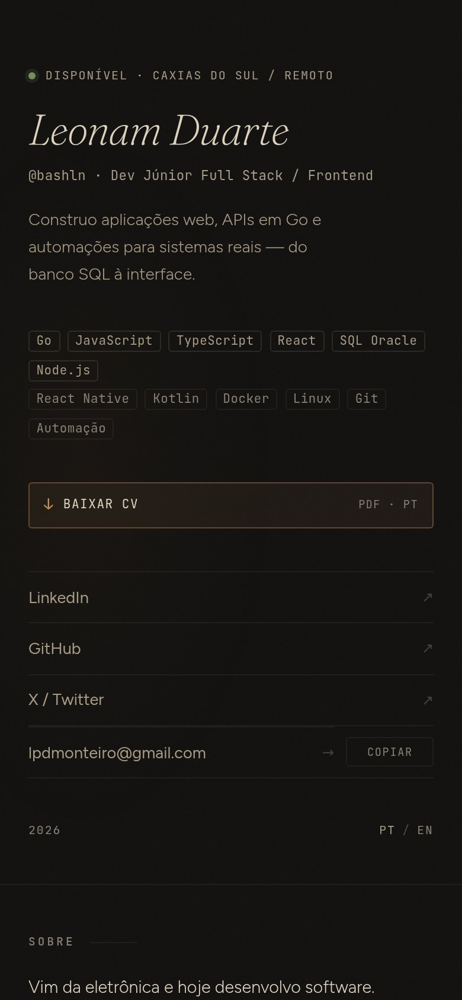
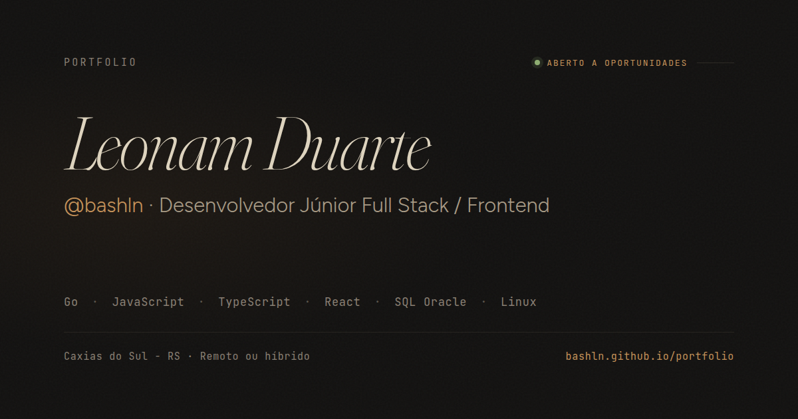

# portfolio

[](https://github.com/bashln/portfolio/actions/workflows/ci.yml)
[](#)
[](#)
[](#)
[](#)

Página pessoal estática, bilíngue e sem build step. Funciona como currículo técnico navegável, com CV em PDF para download. Quem abre entende o perfil, a stack e os projetos em poucos segundos, e alterna entre português e inglês sem recarregar.

## Visão geral e problema resolvido

Currículo em PDF e perfil de rede social não mostram como a pessoa escreve código. Este repositório resolve isso sendo, ele mesmo, a amostra. É uma página única que carrega em qualquer hospedagem estática, mantém o conteúdo em HTML semântico, implementa i18n PT-BR/EN em ~130 linhas de JavaScript vanilla, preserva acessibilidade (contraste WCAG AA, alvos de toque de pelo menos 24px, `prefers-reduced-motion`) e não exige `npm install`, bundler nem servidor para rodar. O valor prático é duplo. O recrutador tem uma vitrine rápida e verificável, e o autor tem um artefato que não apodrece por dependência desatualizada.

## Arquitetura e decisões técnicas

- **Zero dependências de runtime.** Um `index.html`, um stylesheet e um script inline. Nenhum framework, bundler ou pacote instalado, e o deploy é copiar arquivos. A única dependência de desenvolvimento é `html-validate`, chamado via `npx` com a major fixada no `Makefile`.
- **Duas colunas com uma única quebra estrutural.** O layout usa CSS Grid (`minmax(240px, 37%)` / `minmax(0, 63%)`) com a sidebar em `position: sticky` e `height: 100vh`. Abaixo de 860px a grade colapsa para uma coluna e a sidebar vira bloco estático. É um breakpoint real, não uma escada de media queries.
- **Compressão vertical por altura de viewport.** Media queries em `max-height: 820px` e `760px` reduzem paddings, gaps e margens. Medição em 2026-11-19: `scrollHeight` de 1805px em 1440×900 e 1696px em 1366×768. O conteúdo cresceu com a experiência e o fecho de contato, então a página rola; as media queries só reduzem o desperdício.
- **Design tokens em CSS custom properties.** Cores, bordas e famílias tipográficas vivem em `:root`, e os componentes consomem variáveis em vez de valores literais. Os tons de texto secundário atingem contraste WCAG AA no tamanho usado, e todo alvo interativo tem `:focus-visible`.
- **i18n por atributos de dados, sem biblioteca.** Cada nó traduzível carrega `data-pt`/`data-en`, e um único `apply(lang)` percorre o DOM ajustando `textContent`, `<html lang>`, `<title>` e `meta[name=description]`. O mesmo mecanismo cobre atributos acessíveis via `data-aria-pt`/`data-aria-en`, o que evita o clássico `aria-label` fixo em inglês numa página em português.
- **Preferência persistida com degradação segura.** O idioma vem de `?lang=`, depois de `localStorage`, depois do padrão `pt`. Todas as leituras e escritas de storage e de `URLSearchParams` estão em `try/catch`. Com storage bloqueado ou em modo privado, a página cai no padrão em vez de quebrar.
- **Clipboard com caminho de fallback.** O botão de copiar e-mail usa `navigator.clipboard.writeText` quando disponível. Se a API faltar ou a permissão for recusada, ele usa `document.execCommand('copy')` sobre um `textarea` temporário. O retorno é anunciado por uma região `aria-live="polite"`, então leitor de tela também percebe a cópia.
- **Acessibilidade como requisito, não enfeite.** Landmarks semânticos (`aside`, `main`, `section`, `nav`), `role="group"` no agrupamento de stack, ícones decorativos com `aria-hidden`, scrollbar fina para sinalizar conteúdo excedente e `@media (prefers-reduced-motion: reduce)` desligando a animação de entrada e o pulso do indicador de disponibilidade.
- **SEO e compartilhamento declarados no `<head>`.** `canonical`, Open Graph com imagem 1200×630, `twitter:card=summary_large_image`, JSON-LD `schema.org/Person`, `theme-color`/`color-scheme` e a suíte completa de favicons. A imagem social sai de `assets/og-card.html`, versionado como fonte.
- **Verificação automatizada proporcional ao risco.** Um site estático não quebra por lógica. Ele quebra por HTML inválido, por referência de asset quebrada e por tradução pela metade. O `Makefile` roda `html-validate`, `scripts/check-assets.mjs` e `scripts/check-i18n.mjs`. Os três rodam no CI a cada push e pull request.

### Estrutura

```
.
├── index.html                    # página completa: markup, meta tags, i18n e clipboard
├── assets/
│   ├── style/style.css           # tokens, layout, componentes e media queries
│   ├── images/                   # favicons e og.png (1200×630)
│   ├── cv/                       # CV em PDF servido pelo botão "Baixar CV"
│   └── og-card.html              # fonte do card social usado para gerar og.png
├── docs/screenshots/             # previews usados neste README
├── scripts/check-assets.mjs      # verifica referências locais de assets
├── scripts/check-i18n.mjs        # exige par pt/en em todo atributo traduzível
├── .github/workflows/ci.yml      # lint, assets e i18n
├── Makefile                      # serve / lint / assets / i18n / check
├── CHANGES.md                    # histórico de decisões e medições
└── analysis.md                   # inventário técnico do estado atual
```

## Pré-requisitos e instalação rápida

Requisitos: `git`, `python3` (servidor estático) e `make` com `node` 20 ou superior para rodar as verificações. Não é necessário instalar dependências do projeto.

```bash
git clone https://github.com/bashln/portfolio.git
cd portfolio

make serve            # http://localhost:8000
```

Sem `make`:

```bash
python3 -m http.server 8000
```

Rodar as verificações (o mesmo conjunto que o CI executa):

```bash
make check            # lint + assets + i18n
make lint             # apenas HTML
make assets           # apenas referências de assets
make i18n             # apenas pares de tradução
```

Não há variáveis de ambiente, banco ou serviço externo. O site é estático e não lê configuração em runtime.

## Uso, exemplos e demonstração

A página é o produto. Comportamentos observáveis:

| Ação | Resultado |
|---|---|
| Acessar `/?lang=en` | página abre em inglês e persiste a escolha em `localStorage` |
| Clicar em `EN` / `PT` | traduz textos, `lang` do documento, `title`, `meta description` e `aria-label` |
| Clicar em `Copiar` no e-mail | copia o endereço, troca o rótulo por `Copiado ✓` e anuncia em região `aria-live` |
| Clicar em `Baixar CV` | baixa `assets/cv/leonam-duarte-cv-dev-jr-2026.pdf` sem sair da página |
| Abrir em 1366×768 | media queries de altura compactam o layout; a página rola cerca de 930px |
| Abrir abaixo de 860px | grade colapsa para uma coluna e a sidebar deixa de ser sticky |
| Ativar "reduzir movimento" no SO | animação de entrada e pulso do status são desativados |

Desktop a 1280px, página inteira:



Mobile em 390×844:



Imagem social usada em compartilhamentos:



Para regenerar as três imagens depois de mudar a copy, sirva o site e capture cada viewport com o Chrome em modo headless:

```bash
python3 -m http.server 8000 &
chrome --headless --hide-scrollbars --window-size=1280,1810 --screenshot=desktop.png http://localhost:8000/
chrome --headless --hide-scrollbars --window-size=390,844 --screenshot=mobile.png http://localhost:8000/
chrome --headless --hide-scrollbars --window-size=1200,630 --screenshot=assets/images/og.png file://$PWD/assets/og-card.html
```

## Escopo de testes

Não existe suíte de testes unitários, porque o código é uma página estática com um script de apresentação. A verificação automatizada cobre os três modos reais de falha. O HTML inválido ou inacessível quebra o `html-validate` com o preset `recommended`. Uma referência de asset quebrada quebra `scripts/check-assets.mjs`. Uma tradução pela metade quebra `scripts/check-i18n.mjs`, que exige o par `-pt`/`-en` em todo atributo traduzível. Os três rodam em CI. As validações de layout, contraste e overflow estão registradas em `CHANGES.md` com as medições.

## Contato

- GitHub: [@bashln](https://github.com/bashln)
- LinkedIn: [Leonam Monteiro](https://www.linkedin.com/in/leonam-monteiro-679200362)
- E-mail: lpdmonteiro@gmail.com
